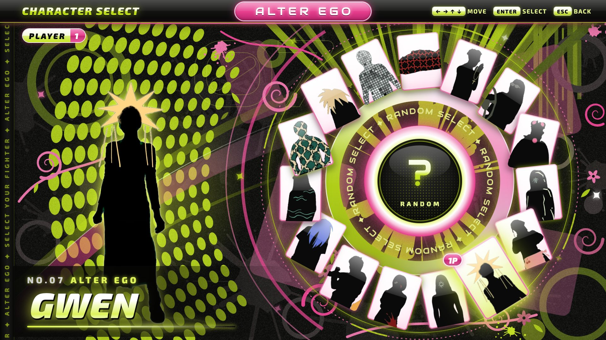
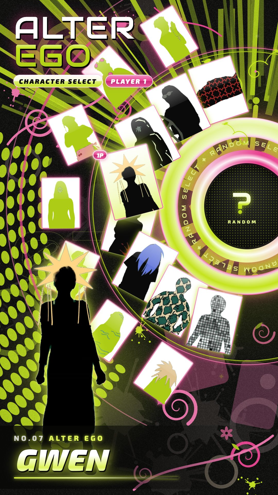

# Alter Ego: character select

A fighting-game character select for the *Alter Ego* trailer by William Yao. Fifteen classmates appear as their alter egos: each has an idle loop and a "selected" move.

**Play it** (in the colours of the *Alter Egos* poster):
- Landscape: https://thewilliamyao.github.io/alter-ego-select/
- Vertical, for vertical video: https://thewilliamyao.github.io/alter-ego-select/poster.html

Earlier looks:
- [Landscape, green](https://thewilliamyao.github.io/alter-ego-select/index-v1.html)
- [Vertical, green](https://thewilliamyao.github.io/alter-ego-select/poster-v1.html)
- [Vertical, laid out like the *Alter Egos* poster](https://thewilliamyao.github.io/alter-ego-select/poster-v2.html)

## Controls

| Action | Keys and mouse |
|---|---|
| Move the cursor | Arrow keys, or hover over a card |
| Select a fighter | Enter, or click (plays their move) |
| Back | Esc, or right-click |
| Random fighter | The ring's centre |
| Hide the hints | H |
| Replay the intro | R |
| Fullscreen | F |

Add `?start=gwen` or `?start=7` to the address to open on a fighter.

## How it's built

- One HTML page; there's no build step.
- The fighters are transparent videos: VP9 with alpha for Chrome and Firefox, HEVC with alpha for Safari.
